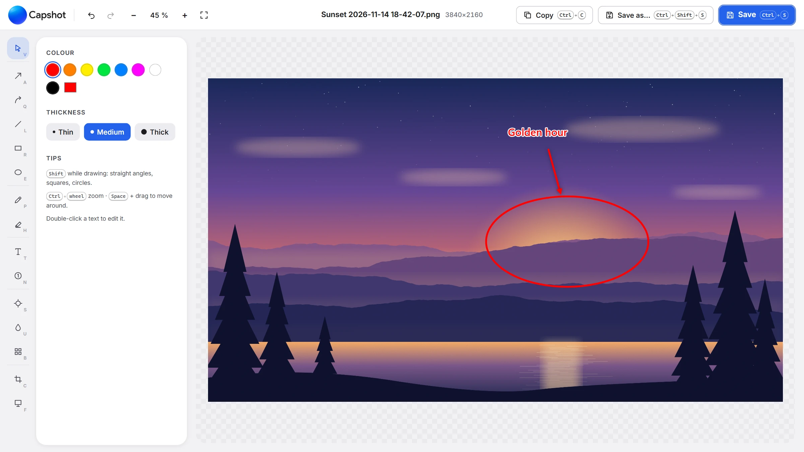
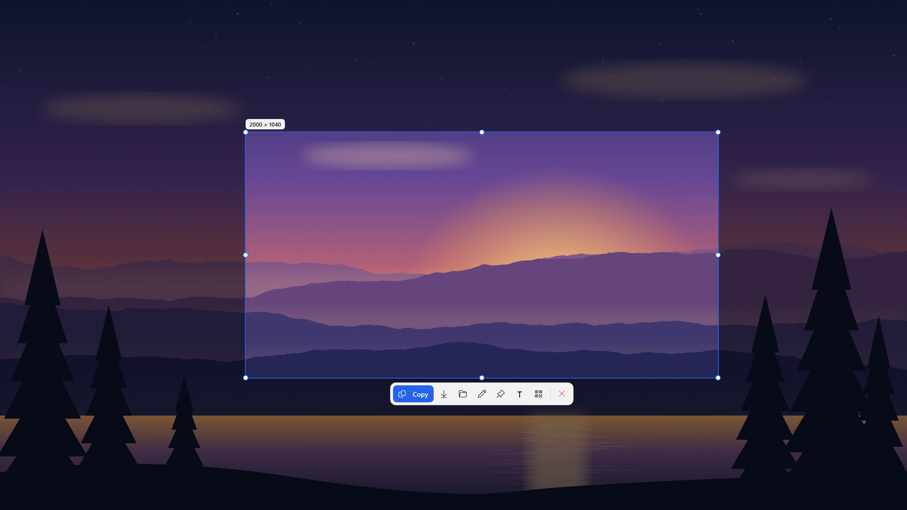
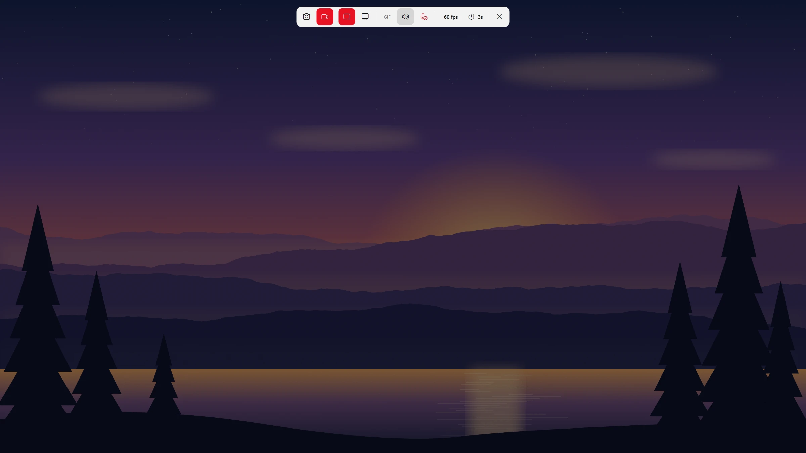
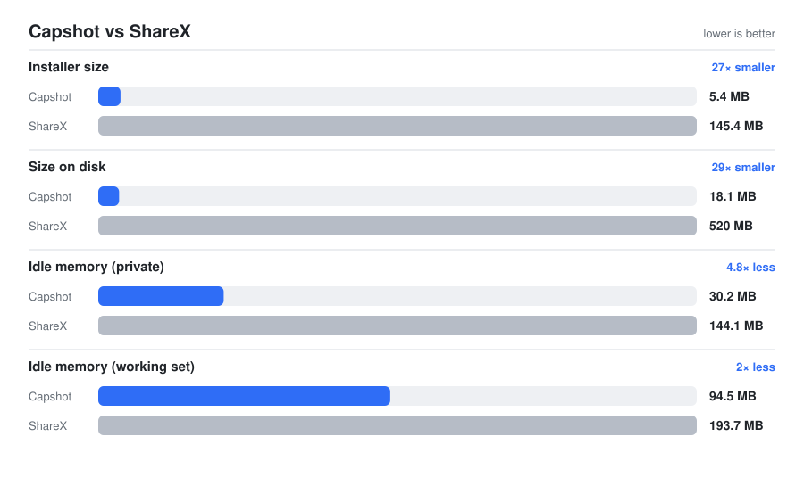

<div align="center">

<picture>
  <source media="(prefers-color-scheme: dark)" srcset="assets/branding/capshot-logo-white.png">
  
</picture>

<br>

**Screenshots, screen recordings and GIFs for Windows.**<br>
Small, fast, open source. An alternative to ShareX with a built-in editor.

<br>

<a href="https://github.com/anthonysworks/capshot/releases/latest/download/Capshot-Setup.exe">
  
</a>

<sub>Always the latest version. Prefer another format? See <a href="https://github.com/anthonysworks/capshot/releases/latest">all releases</a>.</sub>

<br><br>

[](https://github.com/anthonysworks/capshot/releases/latest)
[](LICENSE)


</div>

<br>

<picture>
  <source media="(prefers-color-scheme: dark)" srcset="docs/images/editor-dark.webp">
  
</picture>

<br>

## What it is

Capshot lives in the tray and stays out of the way. Press a key, drag over what you want, and it is on your clipboard. Everything else is optional: save it, annotate it, pin it on screen, read the text out of it, or record the same area as a video.

It is written in Rust. Capture goes through Windows.Graphics.Capture, the selection overlay is drawn natively with Direct2D, and recordings are encoded on the GPU. No webview exists while the app sits in the tray, which is why it idles so low (numbers [below](#how-it-compares)).

## Capture

Press **Print Screen**, select an area, and choose what happens: copy, save, open the editor, pin it above your windows, copy the text it contains, or read a QR code. Nothing is written to disk unless you ask.

<picture>
  <source media="(prefers-color-scheme: dark)" srcset="docs/images/capture-dark.webp">
  
</picture>

## Record

**Shift + Print Screen** starts a recording of an area or a whole screen. MP4 with H.264, HEVC or AV1, up to 240 fps, with system audio and microphone. Prefer a GIF? Record as one directly, or convert any video afterwards by dropping it on the settings window.

<picture>
  <source media="(prefers-color-scheme: dark)" srcset="docs/images/record-dark.webp">
  
</picture>

## Edit

Screenshots open in an editor with arrows, shapes, a highlighter, text, numbered steps, blur and crop. Videos get a timeline editor with trimming, a camera zoom, cursor and click effects, backgrounds and frames.

## And the rest

- Light, dark or follows Windows
- Recent captures in the tray menu
- Updates download quietly in the background and install when you choose to restart
- Settings kept in one readable `config.toml`
- A first-run setup that deals with the Windows Print Screen conflict for you

## How it compares

Capshot against the current ShareX release, measured on the same Windows 11 machine.

<picture>
  <source media="(prefers-color-scheme: dark)" srcset="docs/images/comparison-dark.svg">
  
</picture>

<details>
<summary>How these numbers were obtained</summary>

<br>

- **Installer size**: the `setup` installers published by each project. Capshot 0.1.0, ShareX 22.4.0.
- **Size on disk**: Capshot's installed folder, and ShareX 22.4.0 unzipped from its portable build.
- **Idle memory**: both apps sitting in the tray with no window open. ShareX was launched three times with `-silent` and sampled 32 seconds after start (the mean of the three is shown). Capshot was sampled while idle in the tray. *Private* is private bytes, *working set* is the memory resident in RAM, shared pages included.
- ShareX runs on .NET and ships its own runtime, which accounts for much of the difference. The two apps do not do exactly the same things, and ShareX offers many features Capshot does not (uploaders and automation workflows, for a start).

</details>

## Install

Download the installer above and run it. It installs for the current user, no administrator rights needed. On first launch a short setup picks your shortcuts and folders.

Capshot checks for new versions on its own. You can turn that off, or check by hand, in **Settings → General**.

## Build from source

You need Rust (stable), Node.js and the Windows SDK.

```bash
git clone https://github.com/anthonysworks/capshot.git
cd capshot/app
npm ci
npm run tauri build -- --config '{"bundle":{"createUpdaterArtifacts":false}}'
```

The installer ends up in `target/release/bundle/nsis`. For development, `npm run tauri dev` starts the app with hot reload. Tests and lints run with `cargo test --workspace` and `cargo clippy --workspace --all-targets`.

The flag skips the update signature, which official releases get from a private key kept in CI.

## Contributing

Bug reports and pull requests are welcome. If you plan something big, open an issue first so we can talk about it.

## License

[GPL-3.0-or-later](LICENSE)
